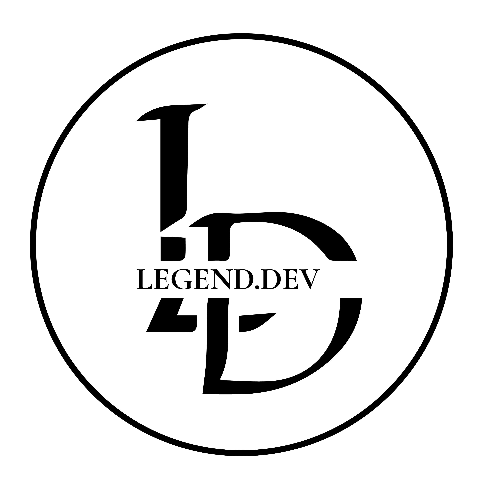
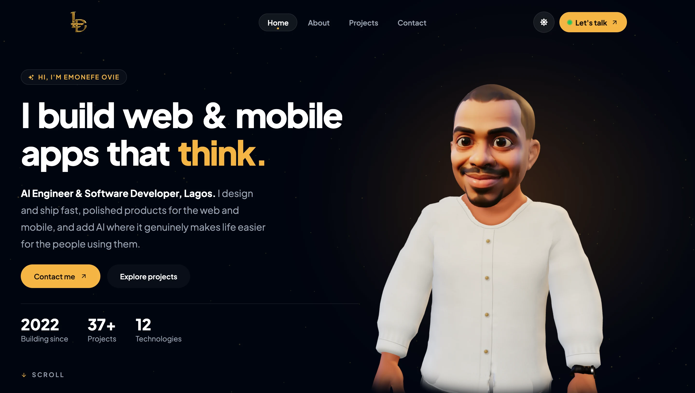

# Personal Developer Portfolio

  

## Overview

This is my personal portfolio, the place where I show who I am as an AI Engineer and Software Developer, the web and mobile apps I've built, and how I like to work. I wanted it to feel fast, simple and easy to read, but still have a personality of its own.

The biggest part of that personality is a 3D version of me. He lives on the homepage, follows your cursor, reacts when you click him, and changes outfits when you switch themes. Around him, the site tries to keep things calm: clear text, smooth transitions and content that's easy to scan.

## Live Demo

Live link: https://legenddev-phi.vercel.app/

## Tech Stack

- React (JavaScript) with Vite
- React Router
- Vanilla CSS
- Framer Motion
- Three.js and React Three Fiber
- React Icons
- EmailJS (for the contact form)
- Blender and Mixamo (to build and animate the 3D avatar)

## Features

### Theme System

The portfolio has a full dark and light mode. Each mode has:

- Its own visual theme
- Its own color palette
- Its own background styling
- A different outfit for the 3D avatar (a brown senator in light mode, white in dark mode)

When you switch, the whole page fades from one theme to the other in one smooth step, and the avatar does a little twirl while he changes clothes. It starts in whatever your device is set to, and once you pick a theme, it remembers it for next time.

### Smooth Animations

Framer Motion and the browser's own View Transitions power small, deliberate animations across the site, including:

- Page transitions (the header stays still while the page glides in)
- Component reveals as you scroll
- Hover interactions
- Navigation feedback
- A "How I build" section that plays through my process on its own

Animations are there to help, not to slow you down. If you've turned on reduced motion on your device, the site respects it.

### The 3D Avatar

This is the part I had the most fun building. On the homepage he:

- Follows your cursor with his eyes and head
- Reacts to clicks, and hides a few Easter eggs (there's a small counter if you want to find them all)
- Turns to look at a project card when you hover over it
- Waves goodbye when you reach the bottom of the page, and welcomes you back when you scroll up

On phones he moves into a small round badge in the corner whenever the text needs the space, and hops back out when there's room. A smaller version of him keeps you company on the other pages. On slow connections or with reduced motion, you get a still picture of him instead.

### Responsive Design

The layout works well on:

- Mobile devices
- Tablets
- Desktop screens

Every page uses flexible layouts and scalable components, so it looks right whatever screen you're on.

## Pages

### Home

A strong first impression: a short intro, the 3D avatar, a bit about me, my selected work, the skills and services I offer, and how I take a project from idea to launch.

### About

My story, from a cyber café in Lagos to building intelligent products: my background, technical skills, how I like to work, and answers to the questions people usually ask me.

### Projects

A collection of my work that shows:

- How I solve problems
- Frontend architecture decisions
- UI implementation
- Real-world use cases

You can filter projects by type, search them, and open each one to see the technologies and the thinking behind it.

### Contact

A simple contact page where you can reach me for collaboration, freelance work or full-time opportunities. As you fill in the form, a little code editor next to it writes your message out as code, and I reply within 24 hours.

### Privacy

A plain-language privacy page that explains what the contact form collects and what happens to it.

### 404

If you land on a page that doesn't exist, the 3D avatar is there to keep you company and point you back home.

## Architecture and Structure

The project is built from reusable components with a clear separation of concerns. All styling lives in vanilla CSS, using shared tokens for colors and text sizes so every page stays consistent.

Core principles followed:

- Component reusability
- Clean folder structure
- Scalable styling approach
- Maintainable state management
- Performance-conscious rendering

On the performance side, the 3D models only load what's needed (the current outfit first, and the avatar's moves in two parts), browsers keep the files cached for return visits, and every page is pre-rendered so search engines can read it.

## Design Philosophy

This portfolio balances minimalism with personality. I wanted it to be clean and easy to read, with every animation and design decision there to help, not distract.

The two themes are about letting people use the site the way they like it, and the overall structure follows modern frontend practices I believe in.

## Purpose

This project is how I show my skills as a developer, both the technical side and the care I put into the experience.

It's a showcase, but it's also an honest example of how I approach building real-world applications.
